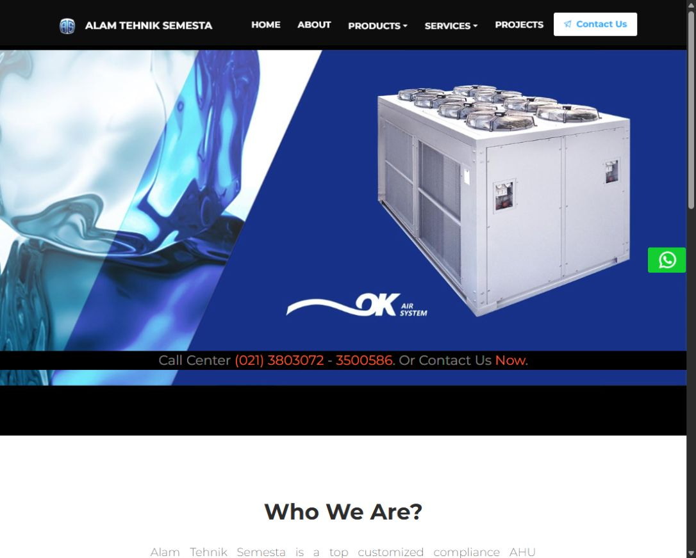
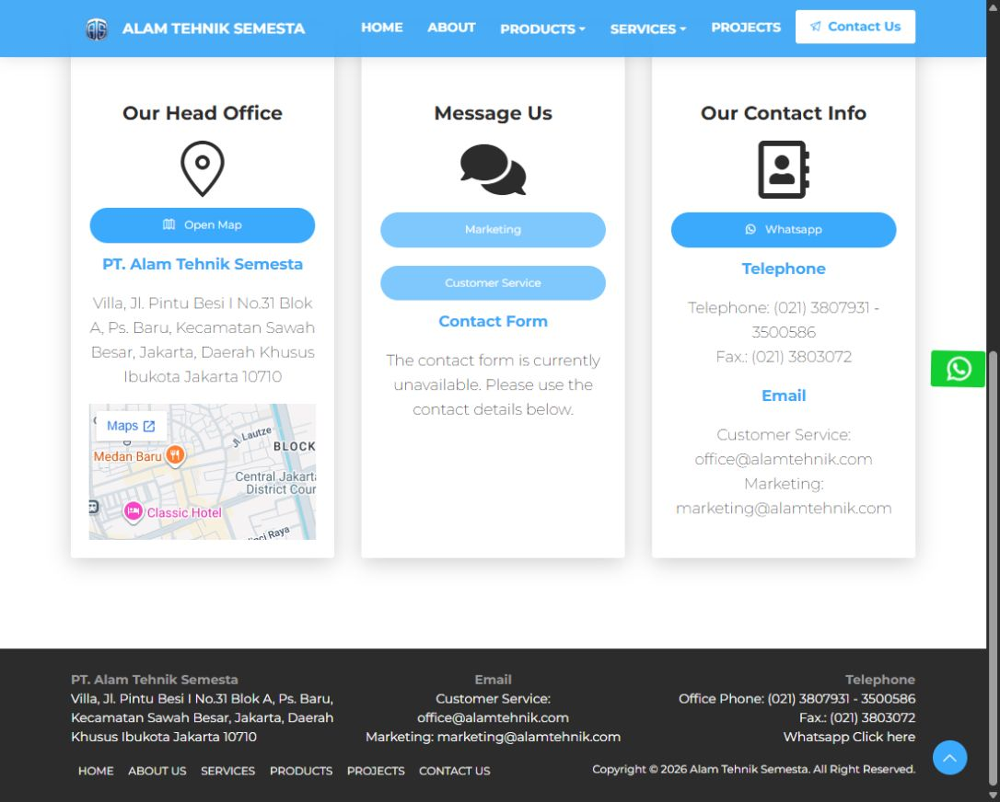

# ATS Company Website

A public-facing React website for PT Alam Tehnik Semesta, presenting its company profile, HVAC products, services, and project experience.

Implementation by Doddie Prawarjito. The interface builds on Now UI Kit React by Creative Tim and Invision; the original license and notices are retained. Company content and imagery retain their original ownership.

## Features

- Company introduction and history.
- Product and service catalogues with reusable cards and carousels.
- Project showcase and contact information.
- Responsive navigation and lazy-loaded page routes.
- Hash routing suitable for static hosting.

## Run and build

```powershell
npm ci
npm start
# Production bundle:
npm run build
```

The repository includes an npm lockfile and keeps legacy peer dependency resolution in .npmrc for its existing Reactstrap / React stack. This preparation does not claim a complete dependency modernization.

## Public deployment

Serve the build directory on a static host. GitHub Pages is compatible with the existing HashRouter; the repository's Pages site is https://mrrobotdude.github.io/. A local successful build does not establish that the current public site contains these changes.

## Contact form configuration

Copy .env.example to .env.local and configure REACT_APP_API_BASE_URL and REACT_APP_SITE_KEY only when a matching contact backend is available. Rebuild after changing frontend environment values. The frontend submits captchaToken to POST /create; the backend must validate it, validate the recipient, and apply rate limits before sending messages.

The contact backend is not part of this repository. Without both values, the form is visibly unavailable and existing public contact details remain accessible. No form points at a visitor's localhost by default.

## Portfolio

Read the [case study](docs/CASE_STUDY.md) and [demo walkthrough](docs/DEMO.md). This company site should keep its company identity; use a separate portfolio project rather than replacing it with personal branding.

## Screenshots





[Validation record](docs/VALIDATION.md).
